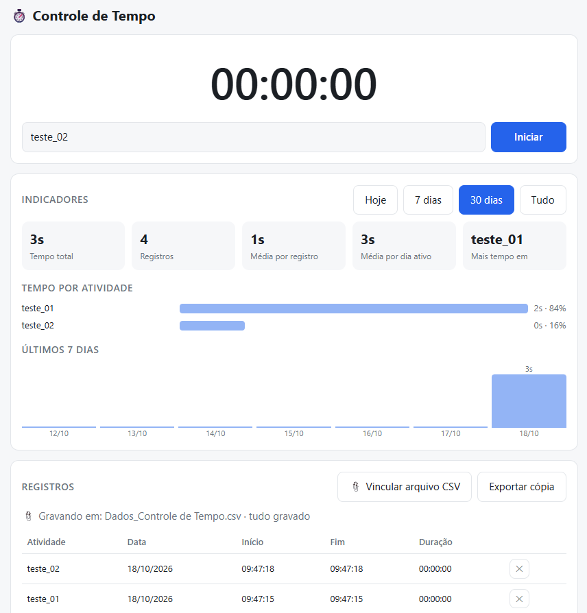

# Controle de Tempo

Programa simples para medir quanto tempo você gasta em cada atividade. Você inicia o cronômetro, faz a atividade e, ao parar, o registro é salvo em uma planilha CSV no seu computador. O programa também mostra indicadores para você analisar o seu tempo.

Tudo roda em um único arquivo (`Controle de Tempo.html`). Não precisa instalar nada, criar conta nem ter internet.

---

## Arquivos

| Arquivo | Para que serve |
|---|---|
| `Controle de Tempo.html` | O programa. Abra no navegador. |
| `Dados_Controle de Tempo.csv` | A planilha onde os registros são gravados. Você cria na primeira vez que vincula. |
| `README.md` | Este guia. |

---

## Requisitos

- **Google Chrome ou Microsoft Edge** em computador (Windows, Mac ou Linux). Eles permitem que o programa grave direto no CSV.
- **Firefox e Safari** abrem o programa e o cronômetro funciona, mas **não** gravam automaticamente no CSV. Neles, use o botão **Exportar cópia**.
- Excel, Google Planilhas ou LibreOffice para abrir o CSV (opcional).

---

## Primeiro uso

1. Coloque o arquivo `Controle de Tempo.html` em uma pasta de sua escolha (por exemplo, Documentos).
2. Abra o arquivo com Chrome ou Edge (dois cliques, ou botão direito → *Abrir com*).
3. Clique em **📎 Vincular arquivo CSV**.
4. Na janela que abrir, o nome já vem sugerido como `Dados_Controle de Tempo.csv`. Escolha a pasta e confirme. Se o Chrome perguntar se você quer substituir um arquivo existente, pode aceitar: o conteúdo anterior é mantido e os novos registros entram no final.
5. Pronto. Essa etapa é feita uma vez só. O navegador lembra o arquivo.

Dica: adicione o `Controle de Tempo.html` aos favoritos para abrir rápido.

---

## Como usar no dia a dia

1. Digite o nome da atividade (por exemplo: *Estudo*, *Reunião*, *Trabalho*). Atividades usadas antes aparecem como sugestão.
2. Clique em **Iniciar** (ou aperte `Enter`). O cronômetro começa a contar.
3. Quando terminar, clique em **Parar**.
4. O registro é salvo no programa e adicionado ao final do CSV.

Detalhes úteis:

- O tempo também aparece no título da aba do navegador, então você vê o cronômetro mesmo em outra aba.
- Se você fechar a aba ou o navegador com o cronômetro rodando, ele **continua contando** quando você abrir o programa de novo. O tempo não se perde.
- Use sempre o mesmo nome para a mesma atividade (com as mesmas letras maiúsculas e minúsculas) para que os indicadores somem tudo junto.

---

## Indicadores

Os indicadores ficam na seção **Indicadores**. Você escolhe o período nos botões: **Hoje**, **7 dias**, **30 dias** ou **Tudo**.

- **Tempo total**: soma de todo o tempo no período.
- **Registros**: quantas sessões foram feitas.
- **Média por registro**: duração média de cada sessão.
- **Média por dia ativo**: tempo médio nos dias em que você registrou algo.
- **Mais tempo em**: a atividade com maior tempo no período.
- **Tempo por atividade**: gráfico de barras com o tempo e o percentual de cada atividade.
- **Últimos 7 dias**: gráfico com o total de cada um dos últimos 7 dias. Ele sempre mostra 7 dias, independentemente do período escolhido.

---

## A planilha CSV

### Colunas

| Coluna | Exemplo |
|---|---|
| Atividade | Estudo |
| Data | 18/10/2026 |
| Início | 14:05:12 |
| Fim | 15:20:47 |
| Duração (hh:mm:ss) | 01:15:35 |
| Duração (minutos) | 75,58 |

### Formato

- Separador de colunas: **ponto e vírgula** (`;`), que é o padrão do Excel em português.
- Codificação **UTF-8**, para os acentos aparecerem certos.
- Decimais com **vírgula**.

### O que acontece em cada ação

- **Parar o cronômetro:** uma linha nova é adicionada ao final do CSV. Se o arquivo estiver vazio, o cabeçalho é criado antes.
- **Excluir um registro (✕):** o registro some do programa e a linha correspondente é **removida do CSV**.
- **Exportar cópia:** gera uma cópia completa com todos os registros, chamada `Dados_Controle de Tempo.csv`. Serve para quem não usa Chrome/Edge ou quer uma cópia de segurança. Cada exportação é um download novo e não altera o arquivo vinculado.

### Analisando no Excel ou Google Planilhas

Abra o CSV e crie tabelas dinâmicas e gráficos com as colunas **Atividade**, **Data** e **Duração (minutos)**. Para somar por atividade, use *Atividade* nas linhas e a soma de *Duração (minutos)* nos valores.

---

## Excluir registros

1. Na tabela **Registros**, clique no **✕** da linha.
2. Confirme a exclusão.
3. O programa procura a linha exata no CSV e a remove.

Situações especiais:

- **CSV aberto no Excel:** o Excel bloqueia o arquivo. O programa avisa e **não apaga nada**, para o app e o CSV não ficarem diferentes. Feche o Excel e tente de novo.
- **Linha editada no CSV:** se você alterou aquela linha no Excel, o programa não a encontra. O registro é apagado do app e você recebe um aviso para remover a linha do CSV manualmente.
- **Registros apagados antes da correção:** versões antigas do programa não removiam linhas do CSV. Se isso aconteceu com você, apague essas linhas manualmente uma vez.

---

## Onde os dados ficam guardados

Existem dois lugares:

1. **No navegador** (armazenamento local): é o que alimenta a tela, os indicadores e a lista de registros.
2. **No CSV**: é a sua planilha, no seu computador.

Pontos importantes:

- O **CSV é o seu backup**. Se você limpar os dados do navegador, mover o programa para outra pasta ou usar outro navegador, a tela pode aparecer vazia, mas o CSV continua intacto.
- O programa **não importa** CSV. Ou seja, não dá para recarregar na tela registros que só existem no arquivo.
- Cada navegador e cada computador tem o seu próprio armazenamento. O programa não sincroniza entre aparelhos.

---

## Problemas comuns

**O botão "Vincular arquivo CSV" não aparece.**
Você está em um navegador sem suporte (Firefox, Safari) ou em um celular, ou abriu o programa dentro de outra página. Abra o arquivo direto no Chrome ou Edge em um computador.

**O navegador pede permissão de novo.**
Normal. Ao reabrir o navegador, o Chrome e o Edge pedem autorização para gravar no arquivo. A pergunta aparece quando você para o cronômetro. Aceite.

**Aparece "Não consegui gravar no CSV".**
Quase sempre é porque o arquivo está aberto no Excel. Feche-o e pare o cronômetro de novo. Registros que não foram gravados ficam marcados como pendentes e são enviados ao CSV na próxima gravação bem-sucedida. A contagem de pendentes aparece acima da tabela de registros.

**O arquivo foi vinculado com outro nome.**
Você digitou outro nome na janela de escolha. O programa avisa. Se quiser o nome padrão, clique em **Vincular arquivo CSV** de novo e escolha `Dados_Controle de Tempo.csv`.

**Os acentos aparecem errados no Excel.**
Abra o arquivo diretamente (dois cliques). Se importar manualmente, escolha a codificação UTF-8 e o separador ponto e vírgula.

**A tela está vazia, mas o CSV tem dados.**
O armazenamento do navegador foi limpo, ou o programa está em outro navegador. Os dados continuam no CSV, mas não são recarregados na tela.

**Quero começar do zero.**
Apague o conteúdo do CSV (ou use um arquivo novo) e limpe os dados do site nas configurações do navegador.

---

## Limitações

- Não há botão de pausa. Para pausar, pare o cronômetro e inicie outro registro depois.
- Não é possível editar um registro nem adicionar um manualmente. Só é possível excluir.
- A tabela de registros mostra os **200 mais recentes**. Os indicadores e o CSV consideram todos.
- A gravação automática no CSV depende de Chrome ou Edge em computador.
- O programa foi conferido por leitura do código, mas a gravação direta no CSV não foi testada em todos os sistemas. Se algo não funcionar, anote a mensagem que apareceu.

---

## Aparência

O programa segue o tema do seu sistema: claro ou escuro, automaticamente. Ele se adapta a telas pequenas, mas a gravação no CSV só funciona em computador.
